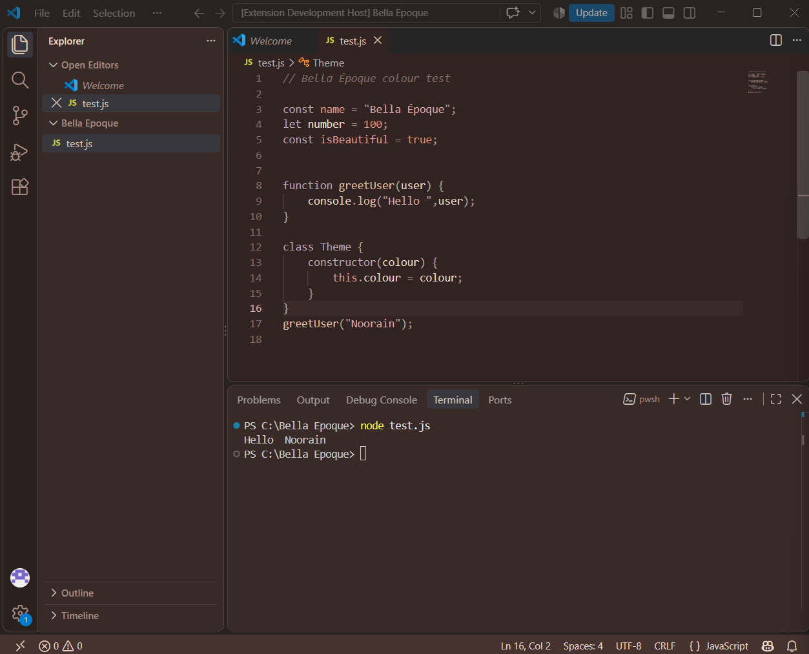
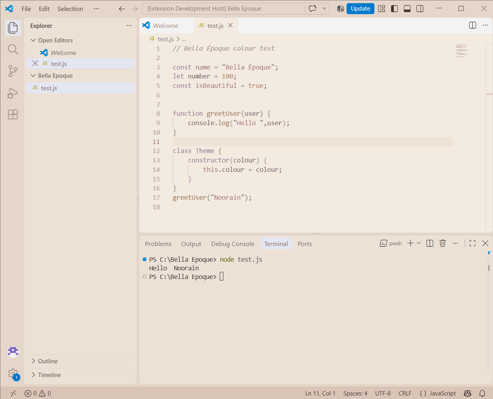

# Bella Époque

A vintage editorial-inspired VS Code theme featuring warm ivory, dusty mauve, muted rose, terracotta, and deep espresso tones.

## Preview

**Bella Époque Dark**

**Bella Époque Light**

## Features

- Two variants: Dark and Light.
- Warm, carefully curated colour palette.
- Vintage editorial-inspired aesthetics.
- Soft, readable syntax highlighting.

## Installation

1. Open **Visual Studio Code**.
2. Go to Extensions (`Ctrl + Shift + X`).
3. Search for **Bella Époque**.
4. Click **Install**.

## Activation

1. Open the Command Palette (`Ctrl + Shift + P`).
2. Select **Preferences: Color Theme**.
3. Choose **Bella Époque Dark** or **Bella Époque Light**.

## Colour Palette

Warm Ivory · Deep Espresso · Dusty Mauve · Vintage Rose · Terracotta · Mushroom Taupe · Soft Sage

## Feedback & Issues

Found a bug or have a suggestion? Feel free to report it through the project's issue tracker.

## License

MIT

---

**Bella Époque** — A little vintage elegance for your coding space.